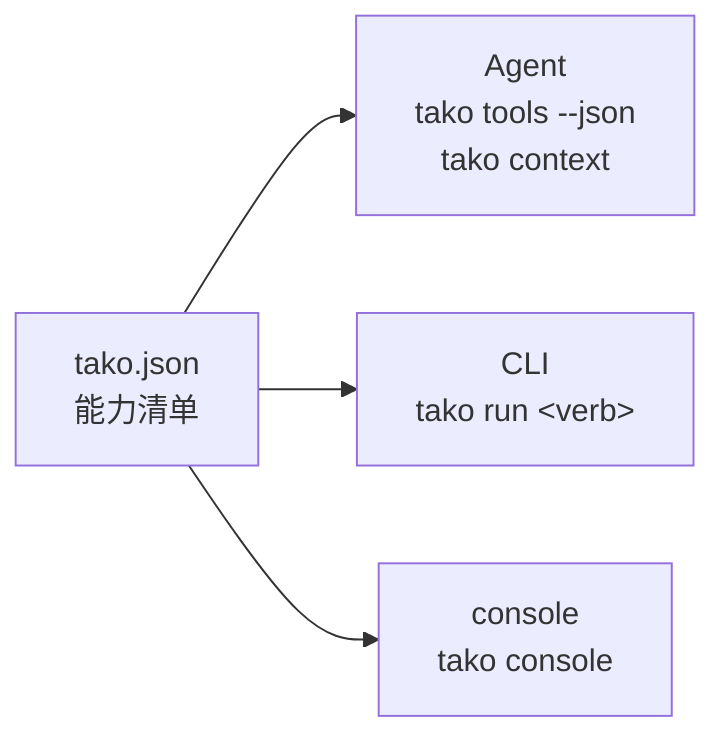

# Tako

> **让 AI 会操作。**
> *Noun in, agent out.*

AI 最难的地方从来不是推理，而是**它什么都碰不到**。

你系统里的能力——重发一次任务、改一个开关、跑一次同步——都长在网页和后台里：一堆按钮、弹窗、菜单。它们说不清输入输出，也说不清副作用，所以人只能用手点，AI 更没法可靠调用。

Tako 干的就是这一层：**把系统里的动作声明成能力，让 AI 能按契约调用。** 而同一份声明，人也能用命令行敲、界面也能渲染成表单。



一份清单，三处生效。这就是 Tako 与普通 CLI 的根本差别：**CLI 只是壳，清单才是本体。**

---

## 术语

> **为什么不用「腕」**：意象词留给 logo —— 功能语境需要零推理的词。
> 「腕」（wàn）与碗 / 晚 / 万同音，且要理解它得先知道 Tako 是章鱼、章鱼有八腕、腕抓东西，四步推理。
> 字段名沿用英文 `arms`（arm 在英文里本就有「业务条线」之义），中文一律叫「连接」。

| 术语 | 对应物 | 说明 |
|---|---|---|
| **清单** Manifest | `tako.json` | 项目的全部能力声明，唯一事实来源 |
| **连接** arm | 一条到平台的连接 | 目标平台（GitLab、Jira、K8s、某个后台）+ 它的地址与鉴权方式 |
| **动词** verb | 一条命令 | 一条可被调用的能力，名字即命令名 |
| **适配器** adapter | 执行方式 | `http` 直连接口 / `script` 本地脚本 / `browser` 浏览器自动化（需驱动插件） |
| **风险等级** risk | 闸门 | `read` 只读 / `write` 改数据 / `destructive` 不可逆（必须 `--yes`） |
| **投喂示例** aiExample | 路由依据 | 告诉 Agent「什么情况下该调用这条能力」 |

---

## 快速开始

```bash
npm install -g @hun-dun/tako
```

安装后命令是 `tako`（包名与命令名解耦，由 `bin` 字段决定）。三步接一套你自己的系统：

```bash
cd my-platform && tako init          # ① 生成 tako.json 骨架
# 编辑 tako.json：把 baseUrl 换成你的平台地址
# export MY_PLATFORM_TOKEN=<令牌>    # ② 令牌只存环境变量，不写进清单

tako doctor                          # ③ 体检：清单、连接、认证

tako ls                              # 看看有哪些能力
tako run ping --dry-run              # 先预览请求，再正式执行
tako tools                           # 导出 Agent 可注册的工具定义
```

本地开发：

```bash
git clone <this-repo> && cd Tako
npm install        # 会自动执行一次构建（prepare 钩子）
npm run build      # 编译 src/*.ts → dist/
./dist/cli.js ls   # 直接跑编译产物
npm link           # 想全局使用 tako 命令时
```

---

## 命令速查

| 命令 | 作用 |
|---|---|
| `tako init [<目录>] [--force]` | 生成 `tako.json` 骨架（1 条连接 + 3 个示例动词） |
| `tako add [<包名>] [--list] [--from <dir>] [--force]` | 装上能力包（`--list` 查看可用包） |
| `tako ls [--arm <name>] [--risk <level>] [--json]` | 列出动词，可按连接或风险筛选 |
| `tako describe <verb> [--json]` | 单条能力的完整说明（含 CLI 用法、表单规格、工具定义） |
| `tako run <verb> [--参数 值] [--dry-run] [--yes] [--json]` | 执行一条能力 |
| `tako tools [--json]` | 输出 AI Agent 工具定义 |
| `tako schema` | 输出清单的 JSON Schema |
| `tako doctor` | 校验清单、连接、环境变量与文档完整性 |
| `tako context [--hook] [--json]` | 输出给 Agent 的清单上下文（`--hook` 供 hook 调用，永不阻断会话） |
| `tako integrate [<目标>] [--list] [--scope <project\|user>] [--dry-run] [--remove]` | 把清单接进 Agent（hook 或 AGENTS.md） |
| `tako ask "<人话>" [--top <n>] [--json]` | 用一句话找动词（本地匹配，best-effort） |
| `tako capture --url <地址> [--seconds <n>] [--write] [--out <file>]` | 录网页操作，反推成 http 动词 |
| `tako verify [<verb>...] [--live] [--include-write] [--params <json>]` | 验证能力能不能真跑 |
| `tako push [<verb>...] --to <目录\|git 地址> [--pack <名>] [--approve] [--list]` | 把能力发布到能力仓库 |
| `tako console [--port <n>] [--open]` | 本地控制台（零依赖、零构建） |

---

## 能力包：基础能力不内置，但开箱可得

文生图、PPT、研发辅助这类能力**不在核心代码里**，而是做成能力包：纯 `tako.json` 声明 + 自包含脚本。

```bash
tako add --list        # 查看可用包
tako add dev           # 研发包：git.recent、todo.scan
tako add office        # 办公包：image.generate、deck.html
```

| 包 | 能力 |
|---|---|
| `dev` | `git.recent` 最近提交、`todo.scan` 待办扫描（纯本地） |
| `office` | `image.generate` 文生图（走接口、需令牌）、`deck.html` 演示文稿（本机生成 HTML，可打印成 PDF） |

装上之后脚本会被拷进 `<项目>/tako-packs/<包名>/`，项目变自包含，可以直接提交 git。详细约定见 [`packs/README.md`](packs/README.md)。

**为什么不内置进核心**：内置会让核心依赖爆炸、认证方式打架、发布节奏被业务拖着走；而 Tako 的全部主张是「能力是数据，不是代码」。判据很简单——**加一条能力如果需要改 `src/`，说明抽象漏了。**

| 全局选项 | 作用 |
|---|---|
| `--file <path>` | 指定清单路径（默认从当前目录向上查找 `tako.json`） |
| `--json` | 机器可读输出，供脚本与 Agent 消费 |
| `--dry-run` | 只打印请求计划，不产生副作用 |
| `--yes` | 确认执行 `destructive` 级动词 |
| `--verbose` | 打印执行细节到 stderr |

**退出码**：`0` 成功 · `1` 运行失败 · `2` 用法或清单错误 · `3` 危险操作被拦截。

---

## browser 适配器：声明式步骤 + 驱动插件

有些能力根本不在接口里 —— 它长在网页上。这时用 `browser` 适配器，用**声明式步骤**描述
「打开页面 → 操作 → 取值」，不需要写代码：

```json
{
  "name": "page.inspect",
  "arm": "web",
  "description": "打开页面，取回标题与列表条数",
  "risk": "read",
  "action": {
    "steps": [
      { "goto": "{{url}}" },
      { "text": "h1", "as": "title" },
      { "count": "li", "as": "itemCount" },
      { "screenshot": "shots/page.png" }
    ],
    "driverOptions": { "headless": true }
  },
  "params": [
    { "name": "url", "type": "string", "required": true, "description": "页面地址" }
  ]
}
```

```bash
tako run page.inspect --url https://example.com/page
tako run page.inspect --url ... --dry-run    # 只看步骤，不启动浏览器
```

支持的步骤：`goto` / `click` / `fill` / `press` / `waitFor` / `wait` /
`text` / `texts` / `attribute` / `count` / `eval` / `screenshot`。
字符串里的 `{{参数名}}` 会被该动词的参数替换；写错参数名会直接报错，不会静默变空。

### 为什么驱动是插件，不在核心里

Node 20 没有内置 `WebSocket`（Node 22 才有），零依赖实现 CDP 要自己写 WebSocket 帧协议 ——
几百行安全敏感代码，直接打破「运行时依赖为 0」。而那条不变量正是 tako 启动速度的来源。

所以分工是：**核心负责「解析步骤 + 托管鉴权 + 找驱动」，驱动由插件提供**。不用浏览器的用户
不必付出这个体积代价。

```bash
npm i -D @hun-dun/tako-adapter-browser   # 官方 Playwright 驱动（含抓包，供 tako capture 用）
```

驱动解析顺序（先具体后抽象，方便本地试验）：

| # | 位置 | 用途 |
|---|---|---|
| 1 | `TAKO_BROWSER_PLUGIN` 环境变量 | 模块名或文件路径，调试用 |
| 2 | `<清单目录>/tako-browser.mjs` | 放一个文件就能用，不必发包 |
| 3 | `<清单目录>/node_modules/…` | 在项目里 `npm i` |
| 4 | 从 tako 自身位置解析 | 全局装一份，所有项目共用 |

`tako doctor` 会直接把「装没装、装在哪」列出来；`tako run` 找不到驱动时报错也会列出
**依次找过哪些位置**，而不是一句 `ADAPTER_NOT_INSTALLED`。

> `driverOptions` 支持 `headless` / `channel`（默认优先用本机 Chrome）/ `slowMo` /
> `persistState`（把登录态存到 `.tako/browser-state.json`，下次复用）。

---

## 从网页录出能力：`tako capture`

手写 `tako.json` 的门槛从来不在 JSON，而在「你得先知道那个系统背后调了什么接口」。
但人早就知道怎么点。所以让 ta 点一遍，我们把请求抓下来反推：

```bash
tako capture --url https://your-page --seconds 60     # 边操作边录
tako capture --url https://your-page --write          # 反推结果直接写入清单
tako capture --url https://your-page --json           # 只看反推结果
tako capture --url https://your-page --out frag.json  # 只要片段
```

反推是**确定性**的，不做花哨猜测：

| 清单里 | 从哪来 |
|---|---|
| 连接 arm | 按请求 origin 生成，`baseUrl` 就是 origin；抓到 Cookie 头则标成 cookie 鉴权 |
| 动词名 | `<首个路径段>.<末个有意义路径段>`，撞名补方法后缀 |
| 路径参数 | 数字 / UUID / 长十六进制段 → `:taskId`（不把某条记录的 ID 固化进清单） |
| 查询参数 | query key 原样保留，类型按捕获值推断（`page=1` → number） |
| 请求体 | JSON 顶层字段逐个变成 body 参数，捕获值当 `example` |
| 风险 | GET/HEAD=read，DELETE=destructive，其余=write |

只有 `xhr` / `fetch` 会被当成接口（页面自身、脚本、图片不是能力）。
**原始捕获永远落盘** `.tako/captures/<时间>.json` —— 反推结果不合心意时，原始记录还在。

> capture 只回答「调什么」。**「何时调用」的 `aiExample` 必须人来写** —— 那句话只能人写，写好了 Agent 路由才准。命令结束时会提醒你这件必做的事。

---

## 验证：`tako verify`

capture 和 `add` 都会往清单里塞动词，而这些动词从没被跑过。verify 就是那道门。

```bash
tako verify                                  # 静态体检（零副作用）
tako verify --live                           # 真的调用只读能力
tako verify --live --include-write           # write 级也跑
tako verify git.recent --live --params '{"count":3}'   # 指定动词 + 喂参
```

安全性是硬约束而不是提示：**GET 之外的默认不跑**；write 要 `--include-write`；
destructive 要 `--include-write` 且 `--yes` —— verify 自己不该成为最危险的东西。

检查项：连接与适配器、`baseUrl`、鉴权环境变量、脚本存在与越界、browser 步骤与驱动、
必填参数可满足性，最后才是真实调用。退出码 `1` 表示有失败，可直接进 CI。

---

## 能力仓库：`tako push`

能力就是文件（声明 + 自包含脚本），它天然适合被版本控制、被 review、被 fork。
**所以仓库用 git，而不是自建服务** —— 版本、审核、权限、历史，git 已经全都有了。

```bash
tako push --to ./capability-repo                      # 发布全部动词
tako push api.tasks --to git@host:team/repo.git        # 只发一个，推到 git
tako push --to ./capability-repo --approve --reviewer 张三
tako push --to ./capability-repo --list                # 仓库里有什么
tako add demo-tasks --from ./capability-repo            # 消费（也支持 git 地址）
```

仓库形状：

```
index.json          包名 → 版本 / 动词 / 摘要 / 发布者 / 审核状态
<pack>/tako.json    包清单（只含被推送的 verbs 与它们依赖的 arms）
<pack>/meta.json    元数据（版本、摘要、审核状态）
<pack>/scripts/…    script 动词的脚本，一起搬走 —— 包必须自包含
```

两个细节：

- **摘要（digest）只覆盖内容，不含时间戳** —— 否则每次跑摘要都变，`内容有变化` 就失去意义；
- **审核状态写在文件里**（`pending` / `approved`）且随 git 追溯，不藏在某个服务里。

---

## 控制台：`tako console`

```bash
tako console --open      # 打开 http://127.0.0.1:7788/
```

零依赖、零构建：直接用 `node:http` 提供一份自包含页面。
受众是「已经装了 tako 的人」，让 ta 为了点一个按钮先跑 `npm install`，是把代价放错了地方。

页面上的数据**全部来自上面的公共 API**（`toFormSpec` / `toCliUsage` / `toToolSpecs` /
`toAgentContext`）—— 和 CLI 用的是同一组函数，这不是「又实现了一遍」，是三端同源可验证之处。

左侧动词列表（可搜索）→ 右侧四个标签页：**表单** / **CLI** / **Agent 工具定义** / **Agent 上下文**，
底部可 `dry-run 预览` 或直接执行；destructive 级动词必须先在页面上勾选二次确认。

安全姿态：**只绑 127.0.0.1**。这是本地工具，不该被局域网访问。

> 想要真正的多页应用（路由、主题、历史记录）时，Vite 才该上场 —— `console/` 那个位置仍然留着，
> 它可以 `import { loadManifest, toFormSpec } from '@hun-dun/tako'`，与本页区别只是换了个壳。

---

## Agent 接入：让 AI 会用

清单本身不会说话。 Agent 端还需一步：把清单喂进模型上下文。这就是 `context` 与 `integrate` 两个命令。

```bash
tako context --hook        # 输出一行 JSON，additionalContext 里就是完整清单摘要
tako integrate --list      # 看看支持哪些 Agent
tako integrate claude-code # 把 hook 注册进 .claude/settings.json
```

两种接入方式，对应两类 Agent：

| 方式 | 适用 | 原理 |
|---|---|---|
| **hook** | 支持生命周期 hook 的 Agent（Claude Code / CodeFlicker） | 会话启动时注入清单，无需 Agent 主动查 |
| **markdown** | 只读项目说明文件的 Agent（Codex 等） | 在 `AGENTS.md` 写入「先跑 `tako context`」的指针 |

markdown 写的是**指针而不是快照**，所以清单永远现取、永不过期。

注册出来的内容长这样，**命令是 `tako context --hook`，不写 node / 绝对路径** ——
因此这份配置可以提交 git，队友装了 tako 就自动生效：

```json
{
  "hooks": {
    "SessionStart": [
      { "hooks": [{ "type": "command", "command": "tako context --hook", "timeout": 10 }] }
    ]
  }
}
```

注：`tako context --hook` 在任何异常下都输出可解析的 JSON —— hook 绝不能因为 tako 自己的问题而阻断用户的会话。

改主意了也能干净回滚，只搞掉自己写入的那条，不碰你原有的配置：

```bash
tako integrate claude-code --remove
```

---

## 在终端里说人话（best-effort）

命令行里没有 LLM，没有人把「帮我看看最近改了什么」翻译成 `tako run git.recent`。
你若在纯终端里（不挂 Agent），可以用 `tako ask` 做一个零依赖的本地调子：

```bash
tako ask "查看最近10条提交记录"
tako ask "扫一下代码里的待办，给我top8"
```

它会拿你的句子去清单里的 `name` / `tags` / `aiExample` / `description` 上打分
（中文按二元组切），返回候选动词、分数、命中词，以及可直接执行的命令。

**为什么只做本地匹配、不内置 LLM**：Tako 的运行时依赖为 0，启动速度就是它最好的特性。
拿不准的语义路由属于 Agent 层（`tako context` + LLM），不属于 CLI 层。
分数过低时它会明说「仅供参考」，而不是编一个自信的答案。

---

## 四条设计原则

**1. 能力即数据**
命令不是散落的 shell 脚本，而是清单里的声明。只有声明式定义，AI 才能知道「能干什么、参数是什么、什么时候该调」。

**2. 先预览，再执行**
每条能力都能 `--dry-run` 出完整的请求计划（方法、URL、脱敏后的请求头、请求体）。副作用必须显式发生。

**3. 认证与地址全托管**
清单里只写「去哪里取令牌」，永远不写令牌本身。适配器统一注入凭证，能力定义里不碰登录逻辑。

```json
{ "auth": { "type": "bearer", "tokenEnv": "DEMO_TOKEN" } }
```

**4. 风险分级是硬闸门**
`destructive` 级能力在没有 `--yes` 时**直接拒绝执行并返回退出码 3**，而不是弹一句「确定吗？」。这是为了让 Agent 复用同一条路径时不会误伤。

---

## 为什么用 TypeScript，以及为什么不用打包器

**TS 的收益不在语法，在契约。** 清单的数据形状被固化在 `src/types.ts` 里，CLI、未来的可视化控制台、适配器实现共用同一组类型——「三端同源」从理念变成了编译期能检查的东西。用户态脚本也能拿到类型：

```ts
import type { ScriptContext } from '@hun-dun/tako';

export default function summary({ params, log }: ScriptContext) {
  log(`top=${params.top}`);
  return { ok: true };
}
```

**不加打包器（Vite / tsup / esbuild）**，理由很具体：

| 方案 | 判断 |
|---|---|
| `vite` | ❌ 前端打包器。不理解 Node 内置模块外部化、`bin`、shebang，用 `--ssr` 硬凑是给 SSR 应用准备的 |
| `tsc` | ✅ 只做 TS→JS。零额外依赖，产物可读、栈追踪准确、`npm link` 可用 |
| `tsup` / `esbuild` | 🟡 打包成单文件，但**本项目运行时依赖为 0**，打包只换来更差的调试体验 |
| `bun build` / `deno compile` | ❌ 想把运行时也绑进来，对 npm 包是反向的 |

判据一句话：**打包解决的是「减少文件数 / 浏览器加载」，CLI 的问题是「启动速度」——而零依赖 + `tsc` 的启动速度已经是最优。**

Vite 在这个项目里有正确的位置：**未来的可视化控制台**（`console/`）。那才是真正的浏览器应用，而它可以直接 `import` 本包的公共 API：

```ts
import { loadManifest, toFormSpec, toCliUsage, toToolSpecs } from '@hun-dun/tako';
```

---

## 目录结构

```
Tako/
├── tako.json               能力清单（3 条连接 + 5 个动词）
├── packs/                  官方能力包（纯声明 + 自包含脚本）
├── adapters/browser/       官方浏览器驱动插件（独立包，依赖 playwright）
├── schema/tako.schema.json 清单的 JSON Schema
├── src/
│   ├── types.ts            领域类型：清单 / 执行 / 投影的完整契约
│   ├── manifest.ts         加载 → 校验 → 归一化 → 三视图投影
│   ├── context.ts          投影四：清单 → 给 Agent 的文本上下文
│   ├── integrate.ts        把清单接进 Agent（hook / AGENTS.md）
│   ├── ask.ts              本地意图匹配：一句话 → 动词候选
│   ├── driver.ts           browser 驱动插件加载与探测
│   ├── capture.ts          录制请求 → 反推 http 动词
│   ├── verify.ts           能力是否真能跑（静态 + live）
│   ├── repo.ts             能力仓库（git 就是仓库）
│   ├── console.ts          本地控制台（node:http，零构建）
│   ├── pack.ts             能力包：装进来即用，核心一行不改
│   ├── run.ts              运行时 + http / script / browser 适配器
│   ├── cli.ts              命令面（bin 入口）
│   └── index.ts            公共 API（CLI 与控制台共用）
├── scripts/summary.mjs     script 适配器示例（用户态代码，不参与编译）
├── demo/index.html         三端同源可视化 demo
├── docs/design.md          清单规格 + CLI 设计 + 适配器接口
└── tsconfig.json           仅 tsc，无打包器
```

> `scripts/summary.mjs` 刻意保留 `.mjs`：它是**运行时被动态 import 的用户态文件**，与项目编译产物无关。Tako 不要求你的脚本用 TS 写；想用 TS，把编译后的 `.js` 路径填进清单即可。

---

## 路线图

- [x] 清单加载、校验、归一化、JSON Schema
- [x] `http` / `script` 适配器，`browser` 适配器接口预留
- [x] CLI / GUI / Agent 三视图投影
- [x] 风险分级与 dry-run
- [x] TypeScript 类型契约与公共 API
- [x] `tako context` / `tako integrate` —— Agent 接入产品化（hook / AGENTS.md）
- [x] `tako ask` —— 本地意图匹配（零依赖，best-effort）
- [x] browser 适配器：声明式步骤 + 驱动插件（含官方 Playwright 驱动）
- [x] `tako capture` —— 录制真人操作，反推出 http 动词（含原始捕获落盘）
- [x] `tako verify` —— 端到端验证（静态默认零副作用，--live 真调用）
- [x] `tako push` —— 能力仓库：git 即仓库，审核状态可追溯
- [x] `tako console` —— 本地控制台（零依赖，复用公共投影函数）

---

## 关于命名与包名

`tako` 这个词是干净的，但 `tako` 这个**标识符**不自由：npm 上的 `tako` 被一个 2012 年的废弃包占着，GitHub 上的 `github.com/tako` 被一个个人账号占着（用户名与组织名共用命名空间）。

所以本项目采用 scope 发布：

- **npm**：`@hun-dun/tako`
- **命令行**：`tako`（由 `bin` 字段提供，与包名解耦）
- **清单文件**：`tako.json`

## License

MIT
