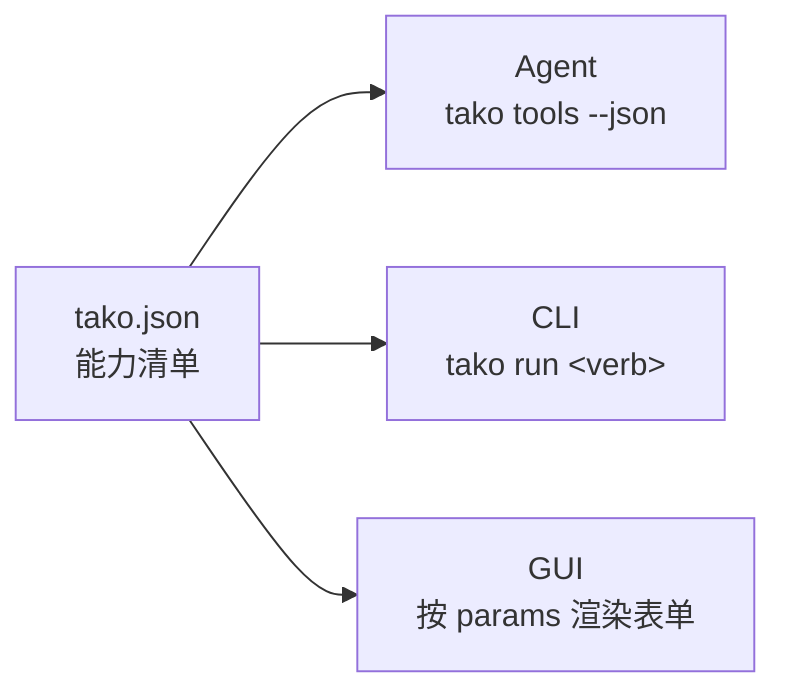

# Tako

> **让 AI 会操作。**
> *Noun in, agent out.*

AI 最难的地方从来不是推理，而是**它什么都碰不到**。

你系统里的能力——重发一次任务、改一个开关、跑一次同步——都长在网页和后台里：一堆按钮、弹窗、菜单。它们说不清输入输出，也说不清副作用，所以人只能用手点，AI 更没法可靠调用。

Tako 干的就是这一层：**把系统里的动作声明成能力，让 AI 能按契约调用。** 而同一份声明，人也能用命令行敲、界面也能渲染成表单。



一份清单，三处生效。这就是 Tako 与普通 CLI 的根本差别：**CLI 只是壳，清单才是本体。**

---

## 术语

> **为什么不用「腕」**：意象词留给 logo —— 功能语境需要零推理的词。
> 「腕」（wàn）与碗 / 晚 / 万同音，且要理解它得先知道 Tako 是章鱼、章鱼有八腕、腕抓东西，四步推理。
> 字段名沿用英文 `arms`（arm 在英文里本就有「业务条线」之义），中文一律叫「连接」。

| 术语 | 对应物 | 说明 |
|---|---|---|
| **清单** Manifest | `tako.json` | 项目的全部能力声明，唯一事实来源 |
| **连接** arm | 一条到平台的连接 | 目标平台（GitLab、Jira、K8s、某个后台）+ 它的地址与鉴权方式 |
| **动词** verb | 一条命令 | 一条可被调用的能力，名字即命令名 |
| **适配器** adapter | 执行方式 | `http` 直连接口 / `script` 本地脚本 / `browser` 浏览器自动化 |
| **风险等级** risk | 闸门 | `read` 只读 / `write` 改数据 / `destructive` 不可逆（必须 `--yes`） |
| **投喂示例** aiExample | 路由依据 | 告诉 Agent「什么情况下该调用这条能力」 |

---

## 快速开始

```bash
npm install -g @hun-dun/tako
```

安装后命令是 `tako`（包名与命令名解耦，由 `bin` 字段决定）。三步接一套你自己的系统：

```bash
cd my-platform && tako init          # ① 生成 tako.json 骨架
# 编辑 tako.json：把 baseUrl 换成你的平台地址
# export MY_PLATFORM_TOKEN=<令牌>    # ② 令牌只存环境变量，不写进清单

tako doctor                          # ③ 体检：清单、连接、认证

tako ls                              # 看看有哪些能力
tako run ping --dry-run              # 先预览请求，再正式执行
tako tools                           # 导出 Agent 可注册的工具定义
```

本地开发：

```bash
git clone <this-repo> && cd Tako
npm install        # 会自动执行一次构建（prepare 钩子）
npm run build      # 编译 src/*.ts → dist/
./dist/cli.js ls   # 直接跑编译产物
npm link           # 想全局使用 tako 命令时
```

---

## 命令速查

| 命令 | 作用 |
|---|---|
| `tako init [<目录>] [--force]` | 生成 `tako.json` 骨架（1 条连接 + 3 个示例动词） |
| `tako add [<包名>] [--list] [--from <dir>] [--force]` | 装上能力包（`--list` 查看可用包） |
| `tako ls [--arm <name>] [--risk <level>] [--json]` | 列出动词，可按连接或风险筛选 |
| `tako describe <verb> [--json]` | 单条能力的完整说明（含 CLI 用法、表单规格、工具定义） |
| `tako run <verb> [--参数 值] [--dry-run] [--yes] [--json]` | 执行一条能力 |
| `tako tools [--json]` | 输出 AI Agent 工具定义 |
| `tako schema` | 输出清单的 JSON Schema |
| `tako doctor` | 校验清单、连接、环境变量与文档完整性 |

---

## 能力包：基础能力不内置，但开箱可得

文生图、PPT、研发辅助这类能力**不在核心代码里**，而是做成能力包：纯 `tako.json` 声明 + 自包含脚本。

```bash
tako add --list        # 查看可用包
tako add dev           # 研发包：git.recent、todo.scan
tako add office        # 办公包：image.generate、deck.html
```

| 包 | 能力 |
|---|---|
| `dev` | `git.recent` 最近提交、`todo.scan` 待办扫描（纯本地） |
| `office` | `image.generate` 文生图（走接口、需令牌）、`deck.html` 演示文稿（本机生成 HTML，可打印成 PDF） |

装上之后脚本会被拷进 `<项目>/tako-packs/<包名>/`，项目变自包含，可以直接提交 git。详细约定见 [`packs/README.md`](packs/README.md)。

**为什么不内置进核心**：内置会让核心依赖爆炸、认证方式打架、发布节奏被业务拖着走；而 Tako 的全部主张是「能力是数据，不是代码」。判据很简单——**加一条能力如果需要改 `src/`，说明抽象漏了。**

| 全局选项 | 作用 |
|---|---|
| `--file <path>` | 指定清单路径（默认从当前目录向上查找 `tako.json`） |
| `--json` | 机器可读输出，供脚本与 Agent 消费 |
| `--dry-run` | 只打印请求计划，不产生副作用 |
| `--yes` | 确认执行 `destructive` 级动词 |
| `--verbose` | 打印执行细节到 stderr |

**退出码**：`0` 成功 · `1` 运行失败 · `2` 用法或清单错误 · `3` 危险操作被拦截。

---

## 四条设计原则

**1. 能力即数据**
命令不是散落的 shell 脚本，而是清单里的声明。只有声明式定义，AI 才能知道「能干什么、参数是什么、什么时候该调」。

**2. 先预览，再执行**
每条能力都能 `--dry-run` 出完整的请求计划（方法、URL、脱敏后的请求头、请求体）。副作用必须显式发生。

**3. 认证与地址全托管**
清单里只写「去哪里取令牌」，永远不写令牌本身。适配器统一注入凭证，能力定义里不碰登录逻辑。

```json
{ "auth": { "type": "bearer", "tokenEnv": "DEMO_TOKEN" } }
```

**4. 风险分级是硬闸门**
`destructive` 级能力在没有 `--yes` 时**直接拒绝执行并返回退出码 3**，而不是弹一句「确定吗？」。这是为了让 Agent 复用同一条路径时不会误伤。

---

## 为什么用 TypeScript，以及为什么不用打包器

**TS 的收益不在语法，在契约。** 清单的数据形状被固化在 `src/types.ts` 里，CLI、未来的可视化控制台、适配器实现共用同一组类型——「三端同源」从理念变成了编译期能检查的东西。用户态脚本也能拿到类型：

```ts
import type { ScriptContext } from '@hun-dun/tako';

export default function summary({ params, log }: ScriptContext) {
  log(`top=${params.top}`);
  return { ok: true };
}
```

**不加打包器（Vite / tsup / esbuild）**，理由很具体：

| 方案 | 判断 |
|---|---|
| `vite` | ❌ 前端打包器。不理解 Node 内置模块外部化、`bin`、shebang，用 `--ssr` 硬凑是给 SSR 应用准备的 |
| `tsc` | ✅ 只做 TS→JS。零额外依赖，产物可读、栈追踪准确、`npm link` 可用 |
| `tsup` / `esbuild` | 🟡 打包成单文件，但**本项目运行时依赖为 0**，打包只换来更差的调试体验 |
| `bun build` / `deno compile` | ❌ 想把运行时也绑进来，对 npm 包是反向的 |

判据一句话：**打包解决的是「减少文件数 / 浏览器加载」，CLI 的问题是「启动速度」——而零依赖 + `tsc` 的启动速度已经是最优。**

Vite 在这个项目里有正确的位置：**未来的可视化控制台**（`console/`）。那才是真正的浏览器应用，而它可以直接 `import` 本包的公共 API：

```ts
import { loadManifest, toFormSpec, toCliUsage, toToolSpecs } from '@hun-dun/tako';
```

---

## 目录结构

```
Tako/
├── tako.json               能力清单（3 条连接 + 5 个动词）
├── packs/                  官方能力包（纯声明 + 自包含脚本）
├── schema/tako.schema.json 清单的 JSON Schema
├── src/
│   ├── types.ts            领域类型：清单 / 执行 / 投影的完整契约
│   ├── manifest.ts         加载 → 校验 → 归一化 → 三视图投影
│   ├── run.ts              运行时 + http / script / browser 适配器
│   ├── cli.ts              命令面（bin 入口）
│   └── index.ts            公共 API（CLI 与控制台共用）
├── scripts/summary.mjs     script 适配器示例（用户态代码，不参与编译）
├── demo/index.html         三端同源可视化 demo
├── docs/design.md          清单规格 + CLI 设计 + 适配器接口
└── tsconfig.json           仅 tsc，无打包器
```

> `scripts/summary.mjs` 刻意保留 `.mjs`：它是**运行时被动态 import 的用户态文件**，与项目编译产物无关。Tako 不要求你的脚本用 TS 写；想用 TS，把编译后的 `.js` 路径填进清单即可。

---

## 路线图

- [x] 清单加载、校验、归一化、JSON Schema
- [x] `http` / `script` 适配器，`browser` 适配器接口预留
- [x] CLI / GUI / Agent 三视图投影
- [x] 风险分级与 dry-run
- [x] TypeScript 类型契约与公共 API
- [ ] `tako capture` —— 用浏览器录制真人操作，自动反推出清单
- [ ] `tako verify` —— 对生成的能力做端到端验证
- [ ] `tako push` —— 能力仓库与共享（带审核）
- [ ] 可视化控制台（Vite 在这里，不在 CLI）

---

## 关于命名与包名

`tako` 这个词是干净的，但 `tako` 这个**标识符**不自由：npm 上的 `tako` 被一个 2012 年的废弃包占着，GitHub 上的 `github.com/tako` 被一个个人账号占着（用户名与组织名共用命名空间）。

所以本项目采用 scope 发布：

- **npm**：`@hun-dun/tako`
- **命令行**：`tako`（由 `bin` 字段提供，与包名解耦）
- **清单文件**：`tako.json`

## License

MIT
